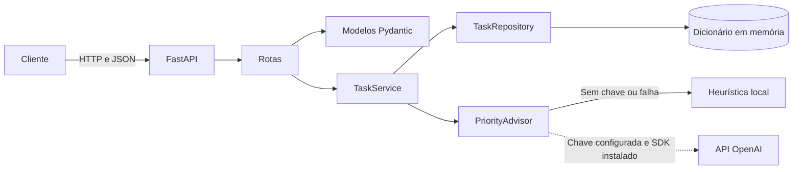

# Micro API de Gestão de Tarefas

API REST para criar, consultar, atualizar e remover tarefas. O MVP usa FastAPI, validação com Pydantic, persistência em memória e sugestão assistida de prioridade por heurística local ou, opcionalmente, por um modelo da OpenAI.

## Requisitos

- Python 3.12
- `pip`
- Uma chave da OpenAI somente se quiser habilitar a sugestão remota de prioridade

## Instalação

Na raiz do projeto, crie e ative um ambiente virtual.

**Windows PowerShell**

```powershell
python -m venv .venv
Set-ExecutionPolicy -Scope Process -ExecutionPolicy RemoteSigned
.\.venv\Scripts\Activate.ps1
```

**Linux ou macOS**

```bash
python3 -m venv .venv
source .venv/bin/activate
```

Instale as dependências declaradas pelo projeto:

```bash
python -m pip install -r requirements.txt
```

## Executar a API

Inicie o servidor de desenvolvimento na raiz do projeto:

```bash
python -m uvicorn app.main:app --reload
```

Por padrão, a API fica disponível em `http://127.0.0.1:8000`.

- Documentação interativa: `http://127.0.0.1:8000/docs`
- Especificação OpenAPI: `http://127.0.0.1:8000/openapi.json`
- Health check: `http://127.0.0.1:8000/health`

## Testes

Com o ambiente virtual ativado e as dependências instaladas, execute a suíte completa:

```bash
python -m pytest
```

Os testes cobrem as regras do serviço, a heurística e o fallback de prioridade, e os principais fluxos HTTP. Os testes de rota usam um repositório novo por teste e não dependem de chamadas externas à OpenAI.

## Como a IA Acelerou Este Projeto

OpenAI Codex e GitHub Copilot foram usados em todas as fases do ciclo de vida do software (SDLC), desde a geração do boilerplate e o apoio a comandos de ambiente e Git até sugestões de arquitetura e refatorações. O maior ganho foi na documentação e na criação de testes. As sugestões, porém, exigiram revisão e validação humanas.

Os modelos locais não tiveram qualidade ou velocidade satisfatórias. Durante a troca de agente ou provider, houve casos de dependências instaladas fora do ambiente virtual e de instruções de formatação, como finais de linha, ignoradas. No início, também houve dificuldade para gerar artefatos e acesso inesperado a áreas do perfil do usuário, levantando preocupações sobre o alcance das permissões concedidas aos agentes.

## Uso da API

Todas as operações usam JSON, exceto `DELETE`, que retorna corpo vazio. Exemplos abaixo usam `curl`.

### Health check

```bash
curl http://127.0.0.1:8000/health
```

Retorna `200 OK`, com estado e timestamp UTC:

```json
{
  "status": "ok",
  "timestamp": "2026-10-17T12:00:00+00:00"
}
```

### Criar tarefa

```bash
curl -X POST http://127.0.0.1:8000/tasks \
  -H "Content-Type: application/json" \
  -d '{"title":"Revisar documentação","description":"Atualizar exemplos da API"}'
```

O campo `title` é obrigatório e deve ter entre 3 e 100 caracteres. `description` é opcional e `status` assume `false` quando omitido. O servidor gera o UUID e o timestamp `created_at` em UTC. A resposta é `201 Created`, por exemplo:

```json
{
  "id": "d6f149d5-2743-47e1-b5f5-c4477028bf88",
  "title": "Revisar documentação",
  "description": "Atualizar exemplos da API",
  "status": false,
  "created_at": "2026-10-17T12:00:00+00:00"
}
```

### Listar tarefas

```bash
curl http://127.0.0.1:8000/tasks
```

Retorna `200 OK` e uma lista de tarefas. Se não houver tarefas, a lista é vazia.

### Consultar uma tarefa

```bash
curl http://127.0.0.1:8000/tasks/d6f149d5-2743-47e1-b5f5-c4477028bf88
```

Retorna `200 OK` com a tarefa, ou `404 Not Found` se o UUID não existir.

### Atualizar uma tarefa

`PUT /tasks/{task_id}` aceita os campos que devem ser atualizados; os demais permanecem inalterados.

```bash
curl -X PUT http://127.0.0.1:8000/tasks/d6f149d5-2743-47e1-b5f5-c4477028bf88 \
  -H "Content-Type: application/json" \
  -d '{"status":true}'
```

Retorna `200 OK` com a tarefa atualizada, ou `404 Not Found` para um UUID inexistente.

### Remover uma tarefa

```bash
curl -X DELETE http://127.0.0.1:8000/tasks/d6f149d5-2743-47e1-b5f5-c4477028bf88
```

Retorna `204 No Content` quando a tarefa existe e `404 Not Found` caso contrário.

### Erros

- `422 Unprocessable Entity`: corpo ou parâmetros inválidos; a resposta inclui `detail` e os erros de validação.
- `404 Not Found`: tarefa inexistente, com resposta `{"detail":"Task not found."}`.
- `500 Internal Server Error`: falha inesperada; detalhes internos são registrados no log, não expostos na resposta.

## Arquitetura



- `app/main.py`: cria a aplicação, registra as rotas e padroniza respostas de erro.
- `app/api/task_routes.py`: define os endpoints HTTP e traduz recursos ausentes em `404`.
- `app/models/task.py`: define os modelos de entrada e saída e valida os dados.
- `app/services/task_service.py`: coordena persistência e ciclo de vida das sugestões de prioridade.
- `app/services/priority_advisor.py`: calcula sugestões localmente e pode consultar a OpenAI.
- `app/repositories/task_repository.py`: implementa o armazenamento em memória.

## Sugestão de prioridade por IA

A prioridade é calculada durante a criação ou atualização da tarefa, mas **não faz parte da resposta da API e não há endpoint público para consultá-la**. Ela é mantida internamente pelo serviço.

Por padrão, o `PriorityAdvisor` usa uma heurística determinística sobre título e descrição: termos como `critical`, `urgent` ou `crítico` sugerem `high`; termos como `backlog`, `later` ou `quando possível` sugerem `low`; nos demais casos, a sugestão é `medium`.

A integração com a OpenAI é opcional. Para ativá-la:

1. Instale o SDK opcional:

   ```bash
   python -m pip install openai
   ```

2. Configure a chave no ambiente em que a API será iniciada.

   **Windows PowerShell:**

   ```powershell
   $env:OPENAI_API_KEY = "sua-chave"
   ```

   **Linux ou macOS:**

   ```bash
   export OPENAI_API_KEY="sua-chave"
   ```

`OPENAI_MODEL` é opcional e, por padrão, usa `gpt-4.1-mini`. A aplicação não carrega arquivos `.env` automaticamente. Se o SDK não estiver instalado, a chave estiver ausente, a chamada falhar ou a resposta não for uma prioridade válida, o sistema usa a heurística local. A chamada externa pode acrescentar latência de até 3 segundos; não é necessário configurar a OpenAI para executar a API ou os testes.

## Limitações

- As tarefas e sugestões ficam apenas na memória do processo; reiniciar a aplicação apaga os dados.
- A integração com a OpenAI não é necessária para a operação e depende de SDK, credencial, conectividade e configuração de modelo válidos.
- A prioridade sugerida não é exposta pela API neste MVP.
- Não há autenticação, autorização, isolamento por usuário, paginação ou filtros.
- O servidor iniciado com `--reload` é para desenvolvimento; este repositório não define configuração de produção ou implantação.

## Próximos passos

- Adicionar persistência durável e migrações.
- Definir autenticação, autorização e isolamento dos dados por usuário.
- Expor a sugestão de prioridade em um contrato de API, caso faça parte do escopo futuro.
- Expandir testes para health check, validações e cenários adicionais de erro.
- Preparar configuração de produção, observabilidade e pipeline de integração contínua.
