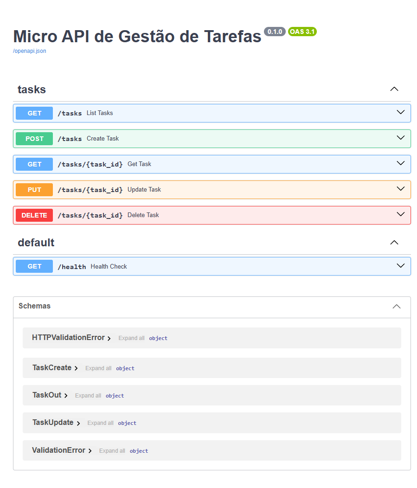
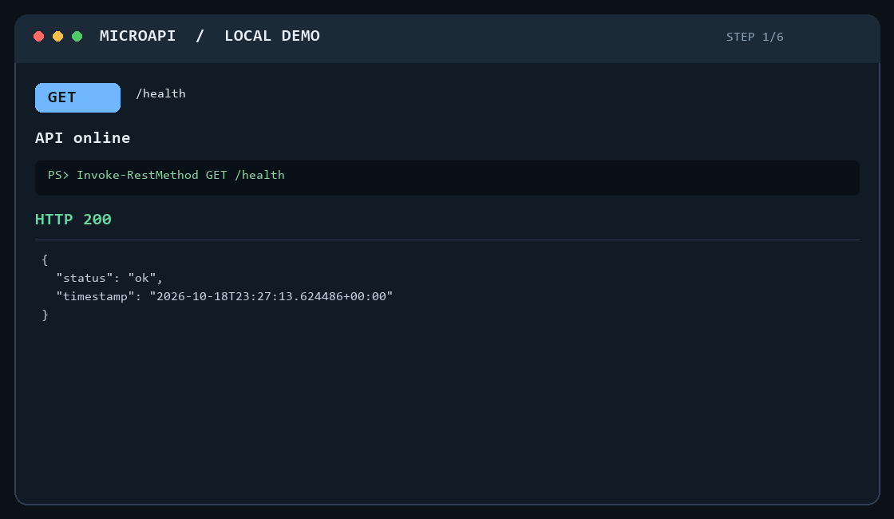
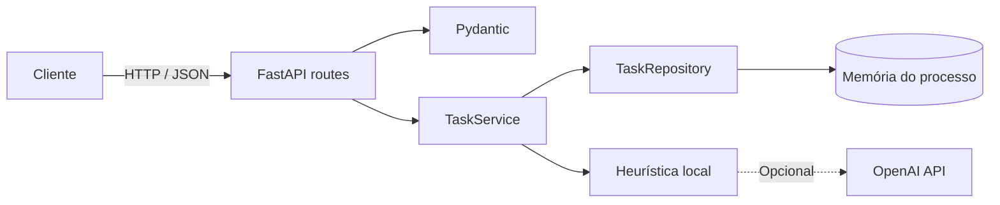

# MicroAPI de Tarefas | Guia Visual

API REST de tarefas com FastAPI, Pydantic e armazenamento em memória. Esta página reúne uma visão visual da documentação e exemplos para exercitar os endpoints localmente.

**Release:** [v1.0.0](https://github.com/AluisioUFG/MicroAPI/releases/tag/v1.0.0)

**Requisitos:** Python 3.12 e `pip`.

## Visão da API



A captura do Swagger mostra a documentação gerada pela aplicação. O badge OpenAPI exibe `0.1.0`, valor padrão do FastAPI neste app; a release do projeto é `v1.0.0`.

## Fluxo CRUD

A animação abaixo foi composta com respostas obtidas em chamadas reais à API local. Ela mostra health check, criação, consulta, atualização, remoção e uma validação `422`.



## Executar localmente

No PowerShell, a partir da raiz do projeto:

```powershell
python -m venv .venv
.\.venv\Scripts\Activate.ps1
python -m pip install -r requirements.txt
python -m uvicorn app.main:app --reload
```

Mantenha o servidor rodando. A documentação interativa fica em `http://127.0.0.1:8000/docs` e o OpenAPI em `http://127.0.0.1:8000/openapi.json`.

## Requisições cURL

Os exemplos usam Bash, Linux, macOS ou Git Bash. Execute-os em sequência; depois do `POST`, copie o UUID retornado e substitua `UUID_DA_TAREFA` nos exemplos seguintes.

### Health check e lista

```bash
curl -i http://127.0.0.1:8000/health
curl -i http://127.0.0.1:8000/tasks
```

### Criar tarefa

```bash
curl -i -X POST http://127.0.0.1:8000/tasks \
  -H "Content-Type: application/json" \
  -d '{"title":"Preparar release","description":"Validar a API"}'
```

Esperado: `201 Created`, com a tarefa e seu `id` na resposta.

### Consultar tarefa

```bash
curl -i http://127.0.0.1:8000/tasks/UUID_DA_TAREFA
```

Esperado: `200 OK` para uma tarefa existente.

### Atualizar tarefa

```bash
curl -i -X PUT http://127.0.0.1:8000/tasks/UUID_DA_TAREFA \
  -H "Content-Type: application/json" \
  -d '{"status":true}'
```

Esperado: `200 OK` com `status: true`.

### Remover tarefa

```bash
curl -i -X DELETE http://127.0.0.1:8000/tasks/UUID_DA_TAREFA
```

Esperado: `204 No Content`, sem corpo.

### Exemplo de validação

O título precisa ter de 3 a 100 caracteres. Este pedido deve retornar `422 Unprocessable Entity`:

```bash
curl -i -X POST http://127.0.0.1:8000/tasks \
  -H "Content-Type: application/json" \
  -d '{"title":"ab"}'
```

## Testes

Com as dependências instaladas e o ambiente virtual ativo:

```powershell
python -m pytest
```

## Arquitetura e limites



- As tarefas são armazenadas em memória e desaparecem quando o processo reinicia.
- A sugestão de prioridade é interna e não aparece no contrato público.
- A integração OpenAI é opcional; sem chave ou em caso de falha, a heurística local é usada.
- Não há autenticação nem autorização.
- MySQL e implantação em produção são evoluções futuras, não fazem parte desta versão.
